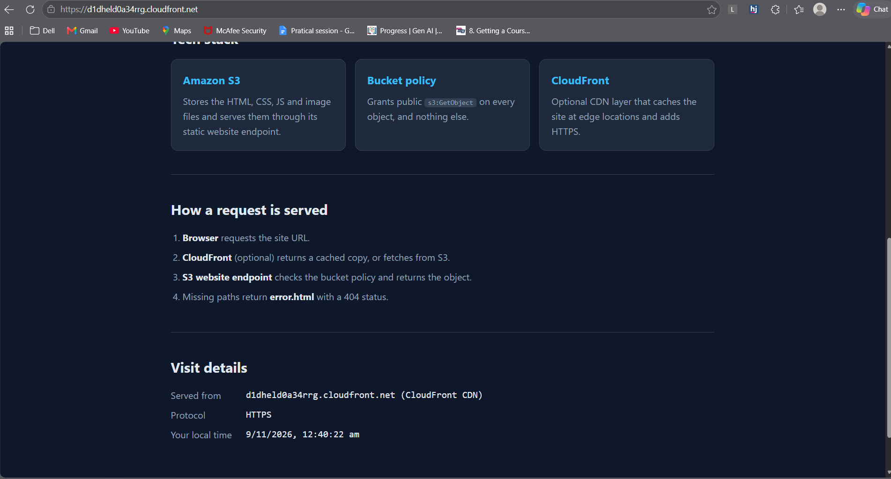

# Task 2 – Static Website Hosting (S3 + CloudFront)

WeIntern Pvt Ltd · Cloud Computing Internship · Week 2

## Summary

A static website (HTML, CSS, JavaScript and an SVG image) is hosted on Amazon S3 using
static website hosting, with a bucket policy granting public read access and custom
index and error documents. An Amazon CloudFront distribution sits in front of the
bucket as a CDN and serves the site over HTTPS.

## Live URLs

| Endpoint            | URL                                                                     |
|---------------------|-------------------------------------------------------------------------|
| S3 website endpoint | http://weintern-task2-viransh-2026.s3-website.ap-south-1.amazonaws.com |
| CloudFront (HTTPS)  | https://d1dheld0a34rrg.cloudfront.net                                   |

Tip: the "Visit details" section at the bottom of the home page shows which endpoint
served the page (S3 website endpoint or CloudFront CDN) and the protocol used.

## Project structure

```
website/
├── index.html        # Home page (index document)
├── error.html        # Custom 404 page (error document)
├── css/
│   └── style.css     # Shared styles for both pages
├── js/
│   └── main.js       # Shows serving host, protocol and a live clock
└── images/
    └── logo.svg      # Logo and favicon
bucket-policy.json    # Public-read bucket policy
```

## Configuration

| Item                    | Value                                                   |
|-------------------------|---------------------------------------------------------|
| Bucket                  | `weintern-task2-viransh-2026`                           |
| Region                  | Asia Pacific (Mumbai) `ap-south-1`                      |
| Block Public Access     | Off (all four settings)                                 |
| Object Ownership        | ACLs disabled (bucket owner enforced)                   |
| Static website hosting  | Enabled, "Host a static website"                        |
| Index document          | `index.html`                                            |
| Error document          | `error.html`                                            |
| Bucket policy           | Public `s3:GetObject` on all objects only               |
| CloudFront distribution | `Week2_distribution` (`E3LCOD30Y9MSQK`)                 |
| CloudFront origin       | S3 website endpoint, origin protocol HTTP only          |
| Viewer protocol policy  | Redirect HTTP to HTTPS                                  |
| Cache policy            | Managed-CachingOptimized                                |
| Billing / security      | Pay-as-you-go, no WAF (demo site)                       |

### Bucket policy

```json
{
  "Version": "2012-10-17",
  "Statement": [
    {
      "Sid": "PublicReadGetObject",
      "Effect": "Allow",
      "Principal": "*",
      "Action": "s3:GetObject",
      "Resource": "arn:aws:s3:::weintern-task2-viransh-2026/*"
    }
  ]
}
```

Only reading objects is allowed; listing, uploading and deleting are not.

## How to deploy

1. **Create the bucket** in S3 (`ap-south-1`) with a globally unique name, ACLs
   disabled, and **Block all public access unchecked**.
2. **Enable static website hosting** under Properties: index `index.html`, error
   `error.html`.
3. **Upload the site** so `index.html` is at the bucket root. Upload the `css`, `js`
   and `images` folders with **Add folder** to keep the folder structure (drag and
   drop can flatten folders, which breaks the CSS, JS and image paths).
4. **Add the bucket policy** under Permissions → Bucket policy (change the bucket name
   in `Resource` if you use a different one).
5. **Verify** by opening the bucket website endpoint, then click "Test the 404 page"
   to confirm the custom error document.
6. **(Optional) CloudFront:** create a distribution whose origin is the S3 *website*
   endpoint (not the REST endpoint), origin protocol HTTP only, viewer protocol policy
   Redirect HTTP to HTTPS. Wait for deployment, then open the `*.cloudfront.net` domain.

To run the site locally instead, open `website/index.html` in a browser. The error
page uses root-relative paths, so it is styled correctly only when served from the
bucket or CloudFront.

## Notes

- The S3 website endpoint supports HTTP only; CloudFront provides HTTPS.
- No Default root object is set on CloudFront: with a website-endpoint origin, S3
  itself serves `index.html` for `/` and `error.html` for missing paths.
- After changing files in the bucket, CloudFront may serve cached copies until the
  cache expires; create an invalidation for `/*` to refresh immediately.

## Cleanup

To avoid charges after evaluation:

1. CloudFront: **Disable** the distribution, wait for it to deploy, then **Delete** it.
2. S3: **Empty** the bucket, then **Delete** it.

## Evidence

Step-by-step documentation with screenshots is in
[`docs/Task2_Static_Website.pdf`](docs/Task2_Static_Website.pdf). The screenshots are
also in [`screenshots/`](screenshots/):

| # | Screenshot | Shows |
|---|-----------|-------|
| 1 | [Block Public Access off](screenshots/01-block-public-access-off.png) | Required before a public bucket policy can be saved |
| 2 | [Bucket created](screenshots/02-bucket-created.png) | `weintern-task2-viransh-2026` in ap-south-1 |
| 3 | [Index and error documents](screenshots/03-static-hosting-index-error-docs.png) | `index.html` and `error.html` configured |
| 4 | [Website endpoint](screenshots/04-static-hosting-endpoint.png) | Static website hosting enabled |
| 5 | [Uploaded objects](screenshots/05-uploaded-objects.png) | `css/`, `images/`, `js/`, `error.html`, `index.html` |
| 6 | [Bucket policy](screenshots/06-bucket-policy.png) | Public `s3:GetObject` only |
| 7 | [Site on S3 endpoint](screenshots/07-site-on-s3-endpoint.png) | Live home page |
| 8 | [Visit details](screenshots/08-visit-details-s3-endpoint.png) | Page confirms it was served by the S3 website endpoint |
| 9 | [Custom 404](screenshots/09-custom-404-page.png) | Error document returned for a missing path |
| 10 | [CloudFront review](screenshots/10-cloudfront-config-review.png) | Origin = S3 website endpoint, no WAF, pay-as-you-go |
| 11 | [CloudFront distribution](screenshots/11-cloudfront-distribution.png) | Domain `d1dheld0a34rrg.cloudfront.net` |
| 12 | [Redirect to HTTPS](screenshots/12-cloudfront-redirect-to-https.png) | Viewer protocol policy |
| 13 | [Site on CloudFront](screenshots/13-site-on-cloudfront-https.png) | Served over HTTPS by the CloudFront CDN |


